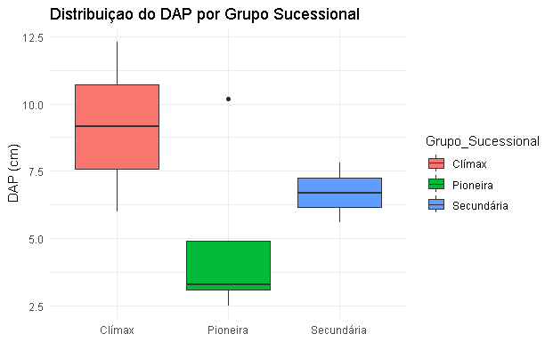
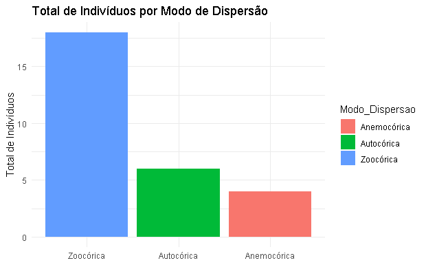
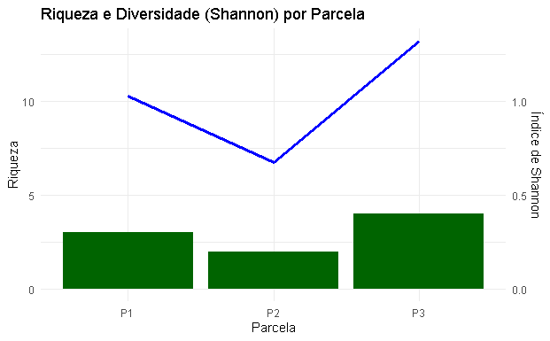

# Análise de dado com R na Restauração Ecológica

## Introdução / Contexto
Buscar colocar em prática o conhecimento básico aprendido no curso de análise de dados do Google "Análise de dados com programação R" na área de Restauração Ecológica.

## 🎯 Objetivo
Usar o RStudio para criar gráficos com os dados de inventário simulado/sintético de árvores de floresta nativa.

## 🛠️ Metodologia, Ferramentas e Dados Utilizados
Uso de IA generativa para criação e otimização dos scrips dos gráficos gerados, com o pacote ggplot2, a fim de pratica de estudo no RStudio.

* **Linguagem R:** pacotes "tidyverse","readxl" , "vegan" e "ggplot2".
* **Fontes de dados:** dados de campo simulados/sintéticos por IA.

## 🗺️ Resultados Visuais

*Figura 1: Gráfico boxplot da distribuição do DAP por grupo sucessional.*

*Figura 1: Gráfico de barras do número total de indivíduos por modo de dispersão.*

*Figura 1: Gráfico da riqueza de espécies e de diversidade (índice de Shannon) por parcela.*
